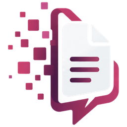
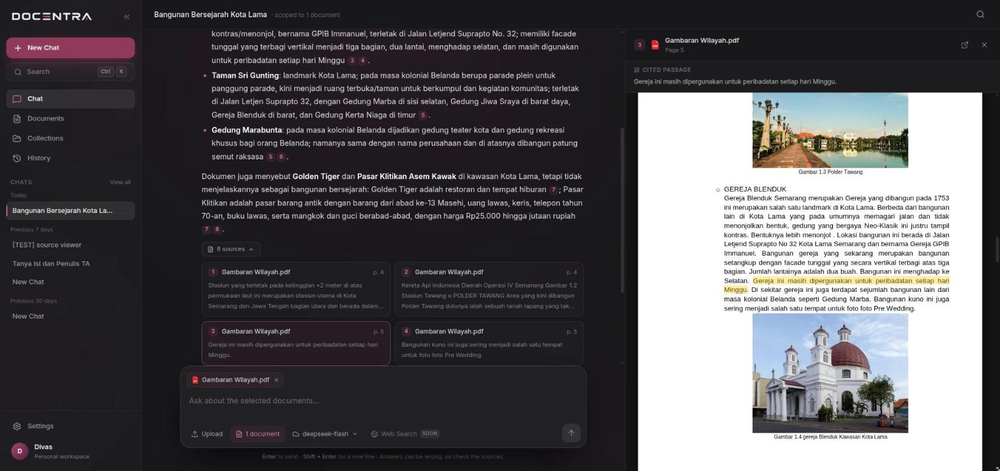
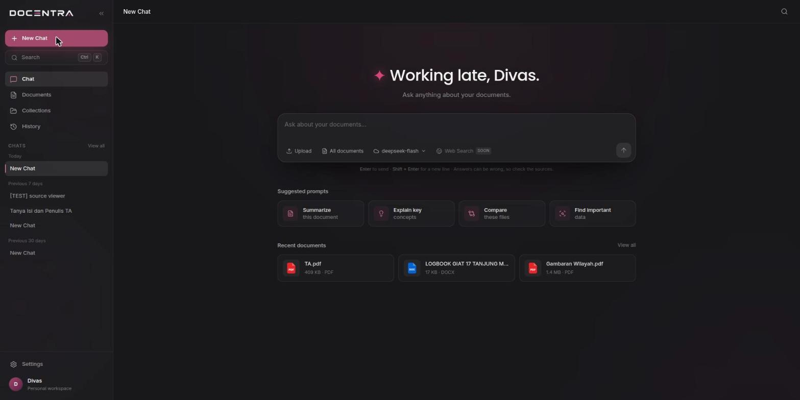
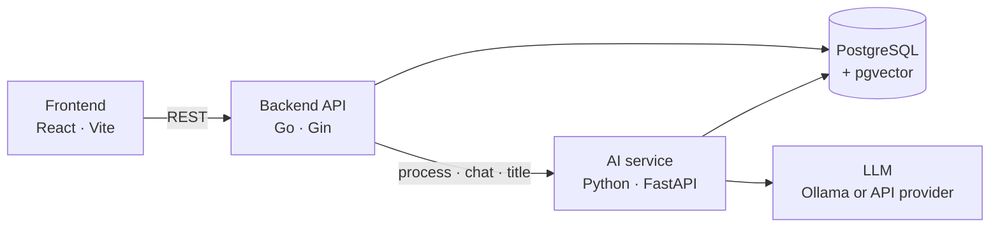

<div align="center">



# Docentra

**Chat with your documents, and see exactly where every answer comes from.**

Upload PDFs, Word files, slides and spreadsheets, ask questions in plain language,
and click any citation to jump to the highlighted passage in the original file.


</div>

<br />



---

## Overview

Docentra is a document intelligence workspace. Instead of digging through file
managers, PDF readers and spreadsheets for one piece of information, you upload
your files once and have a conversation with what is inside them.

Every answer is grounded in your documents. Each claim carries a numbered
citation, and clicking it opens the source file next to the chat, scrolled to the
right page with the quoted passage highlighted, so an answer can be checked in
seconds instead of taken on trust.

**Upload → Understand → Ask → Verify**

## Features

- **Grounded answers with citations.** Every answer cites its sources per claim, with the document name, page and supporting snippet.
- **Streaming answers.** Answers appear word by word as the model writes them; citations are verified and attached once the answer is complete.
- **Source viewer.** Click a citation to open the original PDF, DOCX or text file beside the chat, scrolled to the cited page with the passage highlighted.
- **Multi-format ingestion.** PDF, DOCX, PPTX, XLSX, CSV, TXT and Markdown are parsed, chunked and embedded automatically on upload.
- **Hybrid search.** Retrieval combines pgvector semantic search with Postgres full-text search, merged by reciprocal rank fusion.
- **Document scoping.** Ask across the whole workspace or pin a question to specific documents. Naming a file in the question is detected automatically.
- **Collections.** Group documents into collections and ask a whole collection at once, optionally adding single documents to the scope.
- **Bring your own model.** Run fully local with [Ollama](https://ollama.com), or use OpenAI, Anthropic, Gemini and any OpenAI-compatible provider (DeepSeek, Groq, OpenRouter, Mistral, Together, xAI). API keys stay in the browser.
- **Bilingual.** Answers follow the language of the question (Indonesian or English), backed by a multilingual embedding model.
- **Workspace UI.** Persistent conversations with auto-generated titles, a documents library, history, and a <kbd>Ctrl</kbd> + <kbd>K</kbd> command palette.

<br />



## How it works



1. **Ingestion.** The backend stores the uploaded file and asks the AI service to process it. The file is split into pages, chunked on sentence boundaries, embedded with `paraphrase-multilingual-MiniLM-L12-v2` and written to Postgres with pgvector.
2. **Retrieval.** A question runs through vector and keyword search in parallel. The two rankings are fused, and the top chunks are numbered `[S1]`, `[S2]`, … as context for the model.
3. **Generation.** The model answers using only that context and cites the source numbers it relied on. Citations are mapped back to documents, pages and highlight phrases, then stored with the message.
4. **Verification.** The frontend renders citations as chips. Opening one streams the original file from the backend and highlights the cited passage with pdf.js or docx-preview.

## Tech stack

| Layer      | Technology                                                                 |
| ---------- | -------------------------------------------------------------------------- |
| Frontend   | React 19, TypeScript, Vite, Tailwind CSS, Lucide, pdf.js, docx-preview     |
| Backend    | Go, Gin, pgx, golang-migrate                                               |
| AI service | Python, FastAPI, sentence-transformers, pypdf, python-docx, python-pptx, openpyxl |
| Data       | PostgreSQL 17 with pgvector and full-text search                           |
| Models     | Ollama (default `qwen3:4b-instruct`), OpenAI, Anthropic, Gemini, OpenAI-compatible APIs |

## Getting started

### Prerequisites

- Node.js 20.19+ (or 22.12+), Go 1.25+, Python 3 (developed on 3.14)
- Docker (for Postgres with pgvector)
- [Ollama](https://ollama.com) for local models, or an API key for a hosted provider

### First-time setup

```bash
# 1. Environment files (the DB password must match docker-compose.yml)
cp backend/.env.example backend/.env
cp ai-service/.env.example ai-service/.env

# 2. AI service dependencies (see ai-service/requirements.txt for the CPU-only PyTorch note)
cd ai-service && python -m venv .venv && source .venv/bin/activate \
  && pip install -r requirements.txt && cd ..

# 3. Frontend dependencies
npm install
```

### Run

```bash
./dev.sh           # Postgres + migrations, then AI service, backend and frontend in 3 terminal tabs
./dev.sh --bg      # same, in the background (logs in .dev/)
./dev.sh status    # show what is running
./dev.sh stop      # stop the services (add --db to stop Postgres too)
```

Open **http://localhost:5173**. Hosted models are configured in the app under **Settings**.

<details>
<summary>Running each service manually</summary>

```bash
docker compose up -d                                  # Postgres + pgvector
cd backend && go run ./cmd/migrate up                 # database migrations
cd backend && go run ./cmd/server                     # API         :8080
cd ai-service && source .venv/bin/activate \
  && uvicorn app.main:app --host 0.0.0.0 --port 8000  # AI service  :8000
npm run dev                                           # frontend    :5173
```

</details>

## Project structure

```text
Docentra/
├── src/                    # Frontend (React + TypeScript)
│   ├── components/
│   │   ├── chat/           # Model picker, document scope, upload
│   │   ├── layout/         # Sidebar, main chat, command palette
│   │   ├── viewer/         # Source viewer (PDF, DOCX, text)
│   │   └── ui/             # Shared UI primitives
│   ├── pages/              # Documents, history, collections, settings
│   └── lib/                # API client, model settings, highlighting
├── backend/                # Go API
│   ├── cmd/                # server and migrate entry points
│   ├── internal/           # handlers, services, repositories, AI client
│   └── migrations/         # SQL migrations
├── ai-service/             # Python AI service
│   └── app/
│       ├── rag/            # chunking, embeddings, retrieval, chat, citations
│       └── services/       # file loaders and the processing pipeline
├── docker-compose.yml      # Postgres + pgvector
└── dev.sh                  # one-command dev launcher
```

## Roadmap

- [x] Multi-format upload and processing pipeline
- [x] Hybrid retrieval and document scoping
- [x] Chat with documents, with persistent conversations
- [x] Local and hosted model support
- [x] Per-claim citations with an in-app source viewer
- [x] Collections for grouping documents
- [ ] Web search
- [ ] Authentication and multiple users
- [ ] Production deployment

## About

Docentra is an independent project, built from scratch to explore the
intersection of software engineering, AI and product design: a frontend, a
backend API, an AI service and a document pipeline working together like a real
product rather than an isolated demo.

> **Status:** active development, not production ready. Features and
> architecture may still change.
